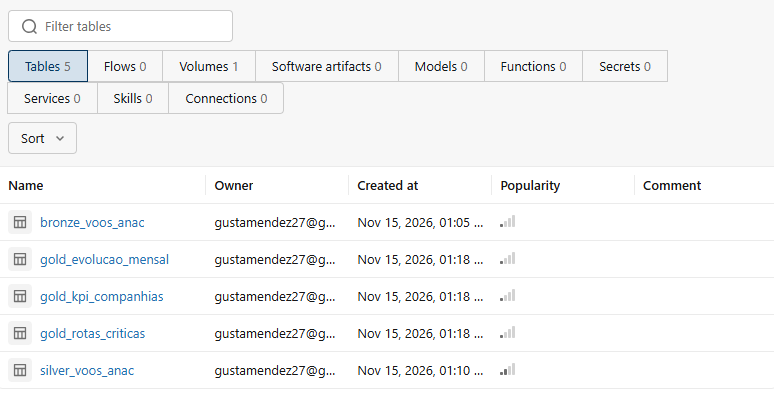
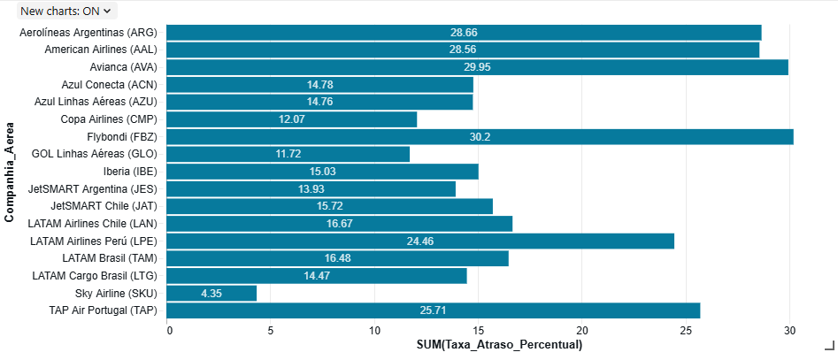
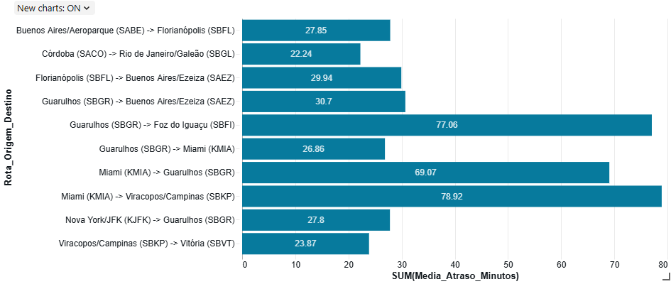

# ✈️ Análise de Pontualidade e Cancelamentos da Malha Aérea Brasileira (ANAC)

Pipeline ponta a ponta de Engenharia e Análise de Dados construído no *Databricks* utilizando *PySpark, **Spark SQL* e *Delta Lake* sob a *Arquitetura Medalhão (Bronze, Silver e Gold)*.

---

## 🎯 Objetivo do Projeto

Processar e analisar *258.301 registros reais de voos* do 1º trimestre de 2026 (VRA - Voo Regular Ativo da ANAC) para identificar gargalos operacionais, taxas de cancelamento, pontualidade das companhias aéreas e as rotas mais críticas do Brasil.

---

## 🏗️ Arquitetura Medalhão (Delta Lake)

O pipeline foi estruturado em três camadas analíticas no Unity Catalog para garantir rastreabilidade, qualidade e performance:

1. *Camada Bronze ([01_ingestao_bronze.ipynb](notebooks/01_ingestao_bronze.ipynb)):*
   * Ingestão distribuída dos microdados brutos em CSV da ANAC.
   * Tratamento de cabeçalho, padronização de nomes de colunas e gravação no formato *Delta Lake* (bronze_voos_anac) com carimbo de data de ingestão.
2. *Camada Silver ([02_tratamento_silver.ipynb](notebooks/02_tratamento_silver.ipynb)):*
   * Limpeza de registros inválidos, deduplicação e conversão segura de timestamps (try_to_timestamp).
   * Criação de regras de negócio: cálculo de *minutos de atraso na chegada* e classificação de pontualidade (No Horário, Atrasado (>15 min) e Cancelado).
   * Enriquecimento das siglas ICAO de companhias aéreas e aeroportos utilizando *Broadcast Join, gerando a tabela silver_voos_anac (258.301 voos tratados*).
3. *Camada Gold ([03_agregacoes_gold.ipynb](notebooks/03_agregacoes_gold.ipynb)):*
   * Modelagem de tabelas agregadas voltadas para tomada de decisão executiva utilizando *Spark SQL* (gold_kpi_companhias, gold_rotas_criticas e gold_evolucao_mensal).

---

## 📊 Principais Insights de Negócio

* *Volume e Operação:* Foram processados *258.301 voos, liderados em volume pela **LATAM Brasil (75.033 voos), **Azul Linhas Aéreas (70.342 voos)* e *GOL Linhas Aéreas (65.712 voos)*.
* *Gargalos em Rotas Internacionais:* Das 10 rotas com maior média de atraso no país, *8 são voos internacionais* (com destaque para conexões entre São Paulo/Florianópolis e Miami, Nova York e Buenos Aires), evidenciando maior complexidade logística e alfandegária nessas malhas.

---

## 📈 Visualizações Geradas

### Taxa de Atraso (>15 min) por Companhia Aérea

### Top 10 Rotas com Maior Média de Atraso

---

## 🛠️ Stack Tecnológica

* *Plataforma Cloud:* Databricks
* *Processamento Distribuído:* Apache Spark / PySpark
* *Linguagem Analítica:* Spark SQL
* *Armazenamento:* Delta Lake (Arquitetura Medalhão)
* *Fonte de Dados:* Microdados Públicos da ANAC (VRA - 1º Trimestre de 2026)

---

## 👨‍💻 Autor

*Gustavo Lima Mendes*  
* [LinkedIn](linkedin.com/in/gustavo-lima-ba5276269)
*
